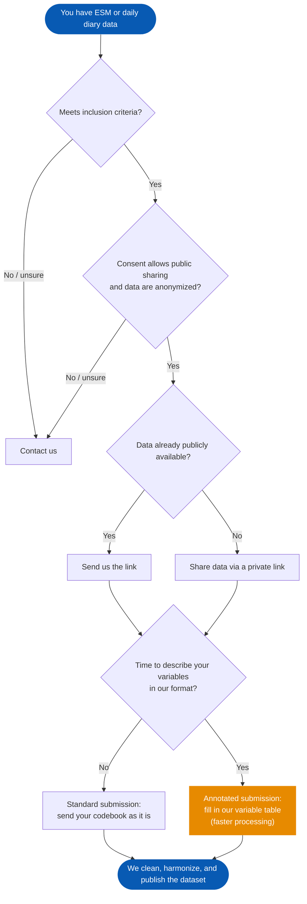

We welcome contributions to the openESM database, both in the form of new datasets and improvements to existing metadata and the software infrastructure.

  On this page
  <a class="docs-topic-chip" href="#adding-a-new-dataset">Add a dataset</a>
  <a class="docs-topic-chip" href="#what-to-send">What to send</a>
  <a class="docs-topic-chip" href="#sharing-your-data">Sharing your data</a>
  <a class="docs-topic-chip" href="#variable-metadata-optional">Variable metadata</a>
  <a class="docs-topic-chip" href="#faq">FAQ</a>
  <a class="docs-topic-chip" href="#contact">Contact</a>

# Adding a New Dataset

You do not need to prepare your data in a specific format to submit them. Send us the data and the documentation you have, and we will clean the data, harmonize variable names and formats, annotate the metadata, and publish the dataset on Zenodo. See the [Dataset Journey]() for details on these steps.

## Before you start

Please check that:

- The dataset meets our inclusion criteria: at least 20 participants, at least 20 possible time points, and at least 2 self-report variables measured repeatedly (see [Data Documentation]()).
- You have permission to share the data publicly, and participants consented to data sharing.
- The data are anonymized. Because the data will be publicly available, it must not be possible to re-identify participants, even in combination with other information. Please follow the data protection rules that apply to you and your institution's guidelines, and contact us if you are unsure.

## Submission process

There are two ways to submit:

- **Standard submission**: send the data and your codebook in whatever form you have it. We do all the annotation.
- **Annotated submission**: additionally describe your variables in our format (see [Variable metadata](#variable-metadata-optional)). Annotating variables takes up most of our time when adding a dataset, so annotated datasets are processed faster.

To start, open a [new dataset submission issue](https://github.com/openesm-project/openesm-metadata/issues) or [contact us](#contact). Please do not attach data files to GitHub issues, as these are public.

## What to send

1. **Data**
   - CSV or Excel files are ideal. Other formats (e.g., SPSS) are also fine, but please list value labels in the codebook rather than only in the data file.
   - Include all parts you can share: the repeated measures (ESM or diary) and, if available, baseline questionnaires and passive/sensor data. Baseline data (especially demographics) and passive data are often harder to anonymize than ESM responses. Please check them carefully, and contact us if you are unsure.
   - Keep rows for prompts that were sent but not answered, if your data contain them.
   - Tell us which values indicate missing data if you use anything other than empty cells, `NA`, or `NaN` (e.g., `-99`).
   - If the data contain timestamps, tell us the time zone.
2. **Codebook or item documentation**. A table with one row per variable (e.g., Excel or CSV) is ideal, but any format is fine (e.g., a questionnaire PDF or the materials section of a paper). Please include as much detail as possible, such as exact item wording, response options and their labels, and any recoding (e.g., reverse-coded items).
3. **License**: by default, we publish datasets on Zenodo under [CC BY 4.0](https://creativecommons.org/licenses/by/4.0/).
   - If the data are already published under a license, we keep that license. It must allow redistribution and modification, as we publish a cleaned version of the data.
   - If the data are online without a license, we cannot redistribute them without your permission. By submitting, you agree to publication under CC BY 4.0, unless you choose a different open license.
   - Let us know if your consent forms restrict how the data may be reused.
4. **Citation**: the DOI of the paper(s) describing the data collection, or another preferred way for others to cite your data.
5. **Optional: variable metadata** in our format (see [below](#variable-metadata-optional)).

## Sharing your data

- **Data already in a public repository** (e.g., OSF, Zenodo): send us the link and tell us the license (see [What to send](#what-to-send)).
- **Data not yet public**: share them through a private link, for example a private OSF project or a password-protected link from your institution's cloud storage. If neither is available to you, contact us and we will send you an upload link.

## Variable metadata (optional)

If you have the time, you can describe your variables in our format. Fill in one row per variable in your data. The main fields are the most useful to us. If you leave the additional fields empty, we fill them in. Full field definitions are in the [Data Documentation]().

**Main fields**

| Field | What to enter |
|---|---|
| `name` | Column name as it appears in your data |
| `description` | Short description, e.g., "Anxious" |
| `details` | Exact item wording shown to participants; for computed variables, how they were computed |
| `labels` | Response labels, e.g., "1 = Not at all, 5 = Extremely" |
| `transformation` | Any changes made to the raw responses, e.g., reverse coding |

**Additional fields**

| Field | What to enter |
|---|---|
| `variable_type` | One of `rating_scale`, `categorical`, `binary`, `numeric`, `PosixCt`, `Date`, `open-text` |
| `answer_categories` | Number of response options, e.g., `5` |
| `source` | Questionnaire the item comes from, or `custom` |
| `assessment_type` | `ESM`, `Daily`, `Passive`, or `Other` |
| `construct` | Construct(s) the item measures, e.g., "anxiety, negative affect" |
| `comments` | Anything else, e.g., "Translated from German" |

**Example**

| name | description | variable_type | answer_categories | details | labels | transformation | source | assessment_type | construct | comments |
|---|---|---|---|---|---|---|---|---|---|---|
| anxious | Anxious | rating_scale | 5 | In the past 15 minutes, I felt anxious. | 1 = Not at all 5 = Extremely | | custom | ESM | anxiety, negative affect, affect | |
| relaxed | Relaxation | rating_scale | 5 | How accurately does each adjective describe your behaviour in the last half hour? Relaxed. | 1 = Extremely inaccurate 5 = Extremely accurate | reverse-coded by the original authors | Mini-Markers for Big Five | ESM | relaxation, positive affect, affect, neuroticism, big five | Translated from German |

## After submission

We write a cleaning script for your dataset, harmonize variable names and formats, and annotate the metadata. We may contact you with questions about specific variables. The cleaned data are then published in the [openESM Zenodo community](https://zenodo.org/communities/openesm/) with a DOI and become available on this website and through the R and Python packages.

## FAQ

**Should I include sum scores or other derived variables?**
Item-level data are most important. You can include derived variables as well; please note how they were computed.

**What about open-text responses?**
Include them only if you have checked that they contain no identifying information. Otherwise, remove them before sharing.

**Do I need a GitHub account?**
No. You can also [contact us](#contact) directly.

# Contributing to Existing Datasets

If you find errors or have suggestions for existing datasets, please follow these steps:

1. Open an issue on the metadata [GitHub repository](https://github.com/openesm-project/openesm-metadata) describing the problem or suggestion.
2. If you can, fork the repository and make the changes directly.
3. Submit a pull request with your changes.

# Improving the Software Infrastructure

If you have ideas for improving the openESM software infrastructure, such as the website or data processing scripts, we welcome your contributions. Please follow these steps:

1. Open an issue on the openESM GitHub repository for the website or metadata. Open an issue in the respective software package repositories to improve the software infrastructure.
2. Fork the repository and make your changes.
3. Submit a pull request with a clear description of your changes and their benefits.

# Contact

If you have any questions or need help with contributions, feel free to reach out at .

